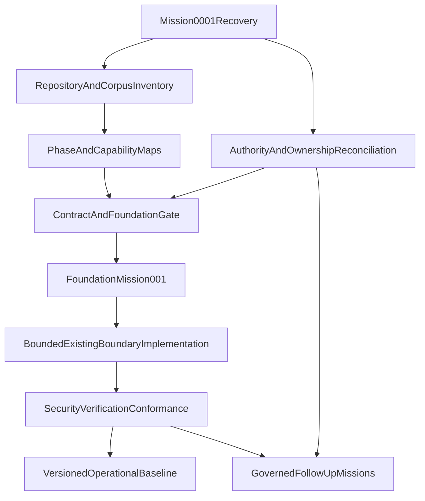

# CoreGrid Repository Recovery and Recomposition Plan

## Current evidence baseline

- The repository contains the 13 mother surfaces, legacy governance artifacts, machine-readable registries, phase contracts, audits, proofs, scripts, runtime code, Supabase migrations, infrastructure definitions, and a large Scholar-origin implementation.
- [`architecture/registry.json`](C:/Users/USER/coregrid-scholar-migration/architecture/registry.json) contains exactly 51 canonical phases. Phase 52 is absent from the registry and has no contract, acceptance record, proof, deployment evidence, or operational evidence.
- [`architecture/COREGRID_PHASE_52_RECONCILIATION.md`](C:/Users/USER/coregrid-scholar-migration/architecture/COREGRID_PHASE_52_RECONCILIATION.md) identifies the neutral corpus as 115,807 lines / 1,844,342 bytes with hash `A69A3E74...CE286`, containing 313 block occurrences and 299 unique bodies. It remains design evidence, not an implementation target.
- [`architecture/phase-completion-status.md`](C:/Users/USER/coregrid-scholar-migration/architecture/phase-completion-status.md) derives 15 `COMPLETE`, 18 `IMPLEMENTING`, and 18 `ARCHITECTURE_DEFINED` phases; the registry/status relationship must remain explicitly reconciled rather than collapsed.
- [`architecture/COREGRID_ARCHITECTURE_TO_CODE_TRACEABILITY.json`](C:/Users/USER/coregrid-scholar-migration/architecture/COREGRID_ARCHITECTURE_TO_CODE_TRACEABILITY.json) shows identity, reality, and workforce partial traces, but mission orchestration breaks at contract/schema/implementation and evidence remains file-plane-only.
- [`architecture/COREGRID_GAP_REGISTER.json`](C:/Users/USER/coregrid-scholar-migration/architecture/COREGRID_GAP_REGISTER.json) records blocked ownership, mission, evolution, and workforce-foundry gaps plus deferred evidence, execution, and conformance gaps.
- [`architecture/COREGRID_FIRST_MISSION_DEFINITION.json`](C:/Users/USER/coregrid-scholar-migration/architecture/COREGRID_FIRST_MISSION_DEFINITION.json) correctly keeps Foundation Mission 001 proposed and blocked pending ownership and contract decisions.
- The exact named Engineering Team Foundry artifact was not located. [`WORKFORCE.md`](C:/Users/USER/coregrid-scholar-migration/WORKFORCE.md) is the conceptual workforce authority; existing agent/Cursor artifacts are adapters or execution definitions, not proof of an executable CoreGrid foundry.

## Required recovery outputs

1. **Repository topology** — inventory source, frontend, backend/API, database/migrations, infrastructure, runtime, agents, tests, scripts, configuration, CI/CD, deployment, generated artifacts, lockfiles, and scratch/legacy material; classify each as canonical, specialized, compatibility, historical, duplicated, conflicting, or unknown.
2. **Governance topology** — reconcile constitutional authority, the 13 mother surfaces, seven legacy governance artifacts, Luna operating contracts, and AGENTS.md; establish aliases without creating duplicate authorities.
3. **Mother-document topology** — map each mother’s purpose, ownership, inputs, outputs, lifecycle, evidence, and downstream consumers; preserve historical claims while correcting only proven current drift.
4. **Control-plane topology** — reconcile [`CONTROL-PLANE.md`](C:/Users/USER/coregrid-scholar-migration/CONTROL-PLANE.md) with `CONTROL-PLANE-01` through `CONTROL-PLANE-12` and [`architecture/COREGRID_CONTROL_PLANE_RECONCILIATION.md`](C:/Users/USER/coregrid-scholar-migration/architecture/COREGRID_CONTROL_PLANE_RECONCILIATION.md); keep the 12 mechanisms as logical capabilities, not automatic services.
5. **51-phase topology** — produce a phase-by-phase inventory of identity, owner, capability, contract, schema, modules, tests, runtime consumer, acceptance, proof, status, and unresolved gaps.
6. **Phase-52 decomposition map** — preserve the corpus hash and source locations; extract blocks/sections deterministically, deduplicate exact and semantic duplicates, classify blueprint type, and map each item to an existing mother/phase or an evidence-gated candidate boundary.
7. **Capability graph** — normalize capabilities, providers, consumers, dependencies, implementation references, and evidence references; identify duplicates and unmapped implementations.
8. **Ownership graph** — make singular ownership explicit for identity, tenancy, reality, state, evidence, context, missions, workforce, execution, verification, conformance, progress, and evolution; preserve unresolved edges as blockers.
9. **Dependency graph** — validate the sequence `authority → registry → schemas → identity/tenant → reality/state → evidence → context → mission → workforce → execution → verification/conformance → progress → drift/evolution` against actual code and migrations.
10. **Blueprint graph** — classify every blueprint as strategic, architecture, domain, capability, system, runtime, data, reality/causal, security, interface, infrastructure, integration, migration, evolution, research, experimental, operational, policy, or composite; record owner, consumers, dependencies, and scope-lock state.
11. **Reality ontology map** — trace entities, identity, relationships, state, events, observations, evidence, knowledge, memory, time, space, causality, uncertainty, simulation, intervention, action, outcome, and proof; explicitly distinguish unknown, false, predicted, simulated, observed, and verified.
12. **Missing capability register** — expand [`architecture/COREGRID_GAP_REGISTER.json`](C:/Users/USER/coregrid-scholar-migration/architecture/COREGRID_GAP_REGISTER.json) across architecture, reality, data, runtime, intelligence, memory, workforce, mission, control plane, security, verification, operations, economic, sovereignty, testing, and evolution categories, with owner, severity, evidence, action, and verification.
13. **Missing engineering substrate register** — assess schemas, migrations, APIs, events, queues, workers, schedulers, storage, search, identity, authorization, tenancy, secrets, audit, observability, backups, CI/CD, security scanning, model routing, evaluation, integration, metering, localization, accessibility, performance, recovery, and E2E; classify each required/optional/not-required/future/existing/duplicated/missing without installing infrastructure by implication.
14. **Prototype archaeology** — extend [`architecture/COREGRID_PROTOTYPE_ARCHAEOLOGY.md`](C:/Users/USER/coregrid-scholar-migration/architecture/COREGRID_PROTOTYPE_ARCHAEOLOGY.md) with hardcoded identities/roles, fake intelligence, simulated state, placeholder analytics, direct Scholar coupling, orphaned routes/schemas, legacy migrations, and generated artifacts; quarantine only after dependency, replacement, verification, and rollback evidence.
15. **Architecture-to-code map** — extend [`architecture/COREGRID_ARCHITECTURE_TO_CODE_TRACEABILITY.json`](C:/Users/USER/coregrid-scholar-migration/architecture/COREGRID_ARCHITECTURE_TO_CODE_TRACEABILITY.json) for each material capability as `architecture → contract → schema → implementation → runtime → test → execution → evidence → verification → conformance`.
16. **Claimed-completion verification map** — compare registry, derived status, acceptance definitions/proofs, contracts, module resolution, tests, builds, runtime checks, security/RLS checks, deployment evidence, and operational evidence; label claims only as defined, designed, implemented, executed, observed, verified, conformant, deployed, or operational.
17. **Scholar boundary map** — keep students, teachers, parents, schools, classrooms, curriculum, assessment, attendance, grading, and education policy in `runtime-001` unless universal ownership is evidenced; verify that Scholar consumes rather than rebuilds CoreGrid primitives.
18. **Candidate new phases** — evaluate evidence/provenance, spatial, causal/simulation, institutional memory, interoperability, operational intelligence, security intelligence, and other candidates only after existing phase ownership and duplication clusters D1–D7 are reconciled; no candidate is authorized by this plan.
19. **Candidate phase consolidations** — assess D1 memory, D2 knowledge graphs, D3 evolution, D4 twins, D5 simulation, D7 security/trust, and other overlaps using ownership, consumers, compatibility, migration, and verification evidence; do not delete, rename, or merge phases during archaeology.
20. **First CoreGrid foundation mission** — qualify `COREGRID-FOUNDATION-MISSION-001` only after the mission, evidence, and execution owners and contracts are decided; the proposed slice remains reality + identity + tenant + context + mission intent + authorized execution + evidence + verification, with no new phase, infrastructure, autonomous production side effect, broad Phase 52 implementation, or Scholar expansion.
21. **Mission dependency graph** — model Mission 0001 as the parent recovery/recomposition mission with bounded sub-missions for source recovery, governance, phase/corpus reconciliation, blueprint reconstruction, acceptance coverage, foundation contracts, implementation, security, verification, conformance, and operational validation.
22. **Implementation sequence** — execute only after plan approval and authority decisions: preserve snapshot; complete deterministic inventories; reconcile aliases/statuses; expand acceptance definitions without fabricating proofs; resolve ownership; generate governed Phase 52 extracts; approve foundation contracts; implement the smallest existing-boundary slice; run risk-proportional tests; establish a baseline.
23. **Verification strategy** — use deterministic artifact validation, typecheck, unit/contract tests, acceptance probes, authorization/RLS/tenant isolation tests, failure/retry/idempotency/rollback/quarantine tests, runtime/API/database checks when credentials are explicitly available, independent conformance review, drift comparison, and startup/health/recovery checks before operational claims.
24. **Risk register** — track authority conflict, status drift, missing mission/evidence ownership, tenant/security failure, fake intelligence/evidence, dependency/network failure, absent credentials, Phase 52 duplication, irreversible migration, Scholar contamination, and operational overclaiming with explicit controls and escalation routes.
25. **Rollback strategy** — preserve repository and corpus snapshots; make bounded reversible changes; retain historical claims and command outputs; quarantine rather than delete; require approved migration/rollback procedures for data; revert failed code-only changes; establish a new architecture/runtime/verification baseline only after conformance evidence.

## Mission dependency and execution model

## Staged execution after plan approval

- **Stage A — Preserve and observe:** capture repository/corpus identity, run deterministic inventory and validation commands, and record current outputs without changing implementation or canonical authority.
- **Stage B — Reconcile authority:** resolve the 13-surface versus legacy naming/status model, reconcile `CONTROL-PLANE.md`, and record decisions for unresolved ownership rather than silently selecting a convenient source.
- **Stage C — Complete maps:** expand the phase, capability, ownership, dependency, blueprint, reality, archaeology, traceability, and gap artifacts; process Phase 52 in deterministic chunks while preserving global indexes and provenance.
- **Stage D — Qualify acceptance:** generate phase acceptance definitions from existing contracts/blueprints, run probes, preserve `ENFORCED`, `DECLARED`, `IMPLEMENTED_UNWIRED`, and `MISSING` separately, and never fabricate proof for absent runtime behavior.
- **Stage E — Qualify Foundation Mission 001:** approve mission/evidence/execution ownership, schemas, authority boundaries, tenant/security rules, failure semantics, evidence requirements, and independent verification criteria. Until this gate passes, implementation remains blocked.
- **Stage F — Implement the first vertical slice:** reuse the existing TypeScript/Supabase/TanStack/Nitro substrate; add only approved contracts and bounded modules; avoid new phases, stores, queues, graph/vector systems, microservices, or production side effects.
- **Stage G — Verify and conform:** execute targeted security, tenant, provenance, failure, idempotency, rollback, conformance, typecheck, unit, build, and environment-appropriate runtime checks; classify unknown or unavailable evidence explicitly.
- **Stage H — Baseline and evolve:** record architecture, registry, blueprint, schema, implementation, runtime, verification, conformance, known-gap, debt, and risk baselines; open follow-up missions for residual work and repeat the architecture/repository scans.

## Stop conditions

- Stop and preserve evidence on unresolved constitutional or ownership conflicts, missing human authorization, destructive operations, credential/authorization denial, security exceptions, or inability to establish required verification.
- Do not register Phase 52, create a new phase, install infrastructure, perform broad refactoring, delete legacy artifacts, or claim operational completion from documentation or worker output alone.
- The first implementation target is therefore not Phase 1 and not Phase 52; it is the smallest approved, evidence-backed foundation slice after Mission 0001 reconciliation.